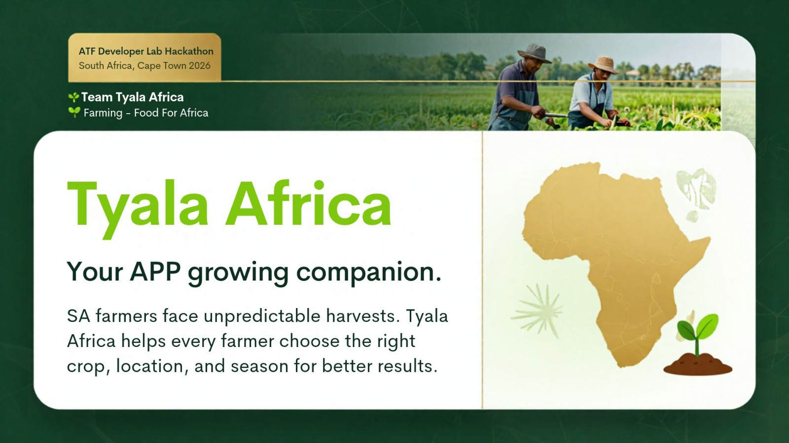
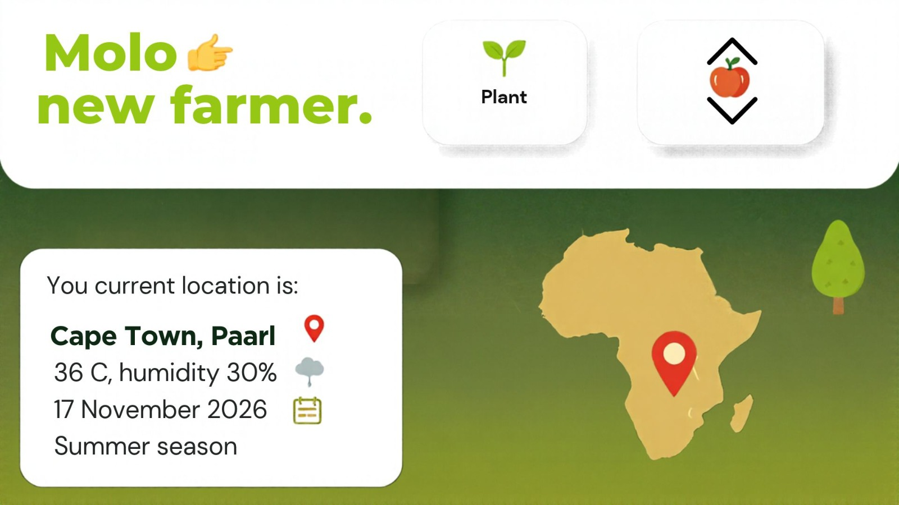
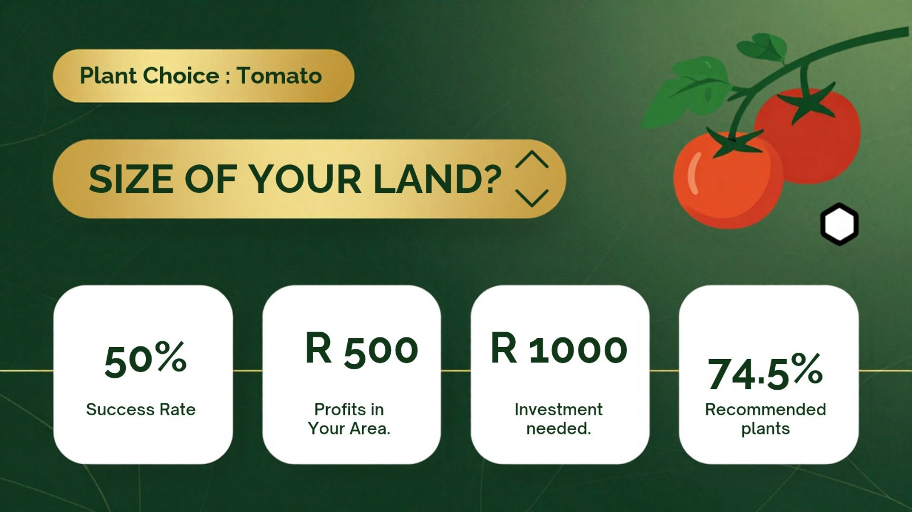
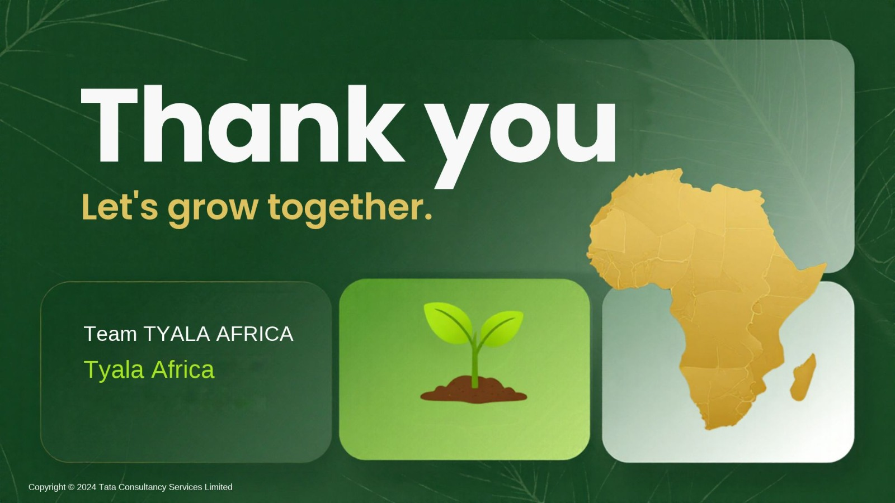

# Tyala Africa

Tyala Africa is a location-first crop advisory for African smallholder farmers: enter your location, and see the crops that have historically been reported there. Evidence is framed honestly — every answer is a historical-records lookup against the pinned HarvestStat-Africa v1.2 release, not the output of a suitability model. The system makes no agronomic claims: it does not rank crops, predict yields, or model phenology. It reports what the data records for your exact administrative area, and every response explains exactly what that means.

## Live demo

Both services are deployed on Railway:

| Service | URL |
| --- | --- |
| API | https://crop-advisory-api-production.up.railway.app |
| PWA (web app) | https://tyala-africa-pwa-production.up.railway.app |

API endpoints:

- `GET /healthz`
- `POST /v1/locations/resolve` — resolve coordinates to a HarvestStat-Africa admin-area FNID
- `POST /v1/recommendations` — the historically reported crop options for one administrative area

## How it works

1. **Place → coordinates, in the browser.** The PWA geocodes an address with OpenStreetMap Nominatim, or reads the device location directly.
2. **Coordinates → administrative area.** The API maps the point to a HarvestStat-Africa admin-area FNID using the pinned v1.2 boundaries and a standard-library point-in-polygon test.
3. **Area → historical crop evidence.** A location-only request returns the historically reported crop options for that exact area: `crop_id`, `crop_label`, `record_count`, `seasons_observed` (planting/harvest months per reported season), `evidence_hint` and response-level `notes`.
4. **Optional single-crop drill-in.** Passing a `crop_id` asks for detail on one crop: planting window, prevalence, confidence band and caveats. When the evidence for that area does not support this assessment, the API answers honestly with a `422` `insufficient_evidence` response instead of inventing a number.

## Sample request and response

A real, verified request against the live API (trimmed):

```http
POST /v1/recommendations
Content-Type: application/json

{"location": {"latitude": -1.2864, "longitude": 36.8172}}
```

Trimmed response (Nairobi, Kenya; first two of the returned options):

```json
{
  "resolved_location": {
    "fnid": "KE2013A147",
    "country_code": "KE",
    "country": "Kenya",
    "admin_level": 1,
    "admin_1": "Nairobi"
  },
  "options": [
    {
      "crop_id": "hsa-v1-2-banana-f9782dd7",
      "crop_label": "Banana",
      "summary": {
        "record_count": 3,
        "seasons_observed": [
          {"season_name": "Annual", "planting_months": [1], "harvest_months": [12]}
        ]
      },
      "evidence_hint": "3 source records across 1 reported season."
    },
    {
      "crop_id": "hsa-v1-2-beans-mixed-b45ec27c",
      "crop_label": "Beans (mixed)",
      "summary": {
        "record_count": 35,
        "seasons_observed": [
          {"season_name": "Annual", "planting_months": [1], "harvest_months": [12]},
          {"season_name": "Long", "planting_months": [3], "harvest_months": [8]}
          // … remaining (Short) season entry trimmed
        ]
      },
      "evidence_hint": "35 source records across 3 reported seasons."
    }
    // … remaining options trimmed
  ],
  "notes": [
    "Options are crops with historical records in the pinned HarvestStat Africa v1.2 coverage index for this exact administrative area; this is not a suitability ranking or recommendation.",
    "Record counts are raw source record counts; no prevalence, share, or ranking is computed.",
    "HarvestStat season and month fields describe reported seasons; they are not phenological timing.",
    "Absence from this list means no indexed historical record in the pinned release; it does not mean the crop is absent or unsuitable."
  ]
}
```

## Architecture

- **API** — `scripts/api_server.py`: a zero-dependency Python API (standard library only) with 23 passing tests. Coordinates → FNID is plain JSON plus point-in-polygon geometry — no spatial database or runtime data service.
- **Data** — pinned HarvestStat Africa v1.2 release: administrative boundaries plus a pre-built coverage index of 217,487 source records across 33 countries, 92 crop labels and 20,177 FNID·crop·season groups.
- **Frontend PWA** — vanilla ES modules with no build step; a stepped shell; service worker offline shell caching; and an earthy, Cappy-derived palette rooted in African agri identity — green `#385819`, orange `#B65512`, alert `#A72503`, ink `#2A2822`, paper `#F4F1E8`, beige `#E6D9B4`.

## Run locally and tests

- **API:** `python3 scripts/api_server.py` — Python standard library only, nothing to install.
- **Frontend:** from the PWA directory, `node --test` (Node's built-in test runner, no extra packages).
- **API base URL:** point the PWA at a different API by setting `window.CROP_API_BASE_URL` before the app modules load.

## Deployment

- Railway project `crop-advisory` hosts two services: `tyala-africa-pwa` and `crop-advisory-api` — the two demo URLs above.
- **CORS is open by design** — `Access-Control-Allow-Origin: *`, methods `GET, POST, OPTIONS`, no credentials (verified live via preflight).
- **Service-level rate limiting is not implemented.** The API contract reserves the `429 rate_limited` response so it can be added without breaking clients; until then the endpoints are open.

## What this data is — and is not

- **Reported seasons, not plant biology.** HarvestStat-Africa calendar fields describe reported seasons, not phenological timing.
- **Coverage, not yields.** `record_count` is raw source coverage — it is not a yield, share, prevalence estimate or ranking.
- **Absence is not impossibility.** A crop missing from the results only means there is no indexed historical record in the pinned release for that area, not that the crop can't grow there.
- **A frame for decisions, not a decision.** Farmers should compare this historical evidence with local advice and their own farm experience.

## Presentation slides

The presentation slides for this project:









## License and attribution

- Crop history and boundaries: [HarvestStat Africa](https://github.com/HarvestStat/HarvestStat-Africa), boundaries pinned to release **v1.2**.
- Address search: [OpenStreetMap Nominatim](https://nominatim.openstreetmap.org/).
